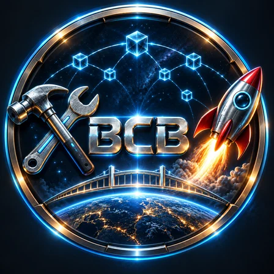
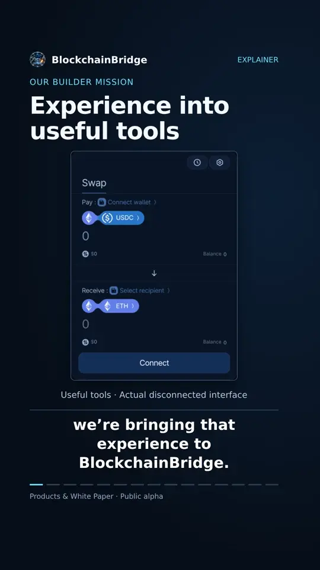

  

<h1 align="center">BlockchainBridge · White Paper</h1>

<strong>Build useful products. Earn revenue. Put a share to work around BCB.</strong>

Public alpha · Built in public

  <a href="https://blockchainbridge.ai/">Explore the platform</a> ·
  <a href="https://blockchainbridge.ai/why-bcb/">Read on the website</a> ·
  <a href="#walkthrough">Watch the walkthrough</a>

---

<a href="#purpose">Purpose</a> · <a href="#allocations">Allocations</a> · <a href="#about">About</a>

> This edition contains the written content of the website’s Purpose, Allocations and About tabs. Expandable text is included in full. References to the “Allocations tab” refer to the Allocations section below.

### Inside the White Paper

- [A Simple Token. A Meaningful Purpose.](#chapter-0)
- [1. Why We Exist](#chapter-1)
- [2. Useful Products. Real Reasons to Use Them.](#chapter-2)
- [3. Where the Revenue Comes From](#chapter-3)
- [4. How Revenue Supports BCB](#chapter-4)
- [5. Familiar Economics. Our Own Model.](#chapter-5)
- [6. What Supporting BCB Actually Means](#chapter-6)
- [7. From Purpose to Proof](#chapter-7)

<!-- white-paper-content:start -->

## Purpose

### A Simple Token. A Meaningful Purpose.

> **Build useful products. Earn revenue. Put a share to work around BCB.**

Blockchainbridge.ai is building an ecosystem of products and services across multiple blockchains, from exchanging assets and moving funds between chains to accessing useful tools and educational blockchain and decentralized finance content.

The starting point is a service someone finds useful enough to pay for. Our goal is to attract customers because our products meet their needs, not simply because they want to buy or trade BCB.

Our model connects that activity to the token. A share of product revenue is allocated to mechanisms that support BCB: contributing liquidity to its markets, purchasing tokens through market buybacks, and funding defined liquidity and ecosystem programs.

BCB itself is a straightforward token. It does not need complicated mechanics to have a meaningful role. Its purpose comes from the ecosystem built around it and the deliberate connection between what our products earn and what those earnings help fund.

> We focus on how the ecosystem supports BCB, not on promising what holding BCB will earn. Useful products are the foundation. Earned revenue provides the resources. Defined allocations connect them to BCB.

---

### 1. Why We Exist

> **A token should have a purpose beyond being traded.**

We are building blockchainbridge.ai around a simple principle: useful products come first. BCB’s relevance should grow from the services built around it and the revenue allocations connecting those services to the token, not merely from expecting the next person to buy it.

Our starting question is not “How do we persuade people to buy BCB?” It is “What can we build that people genuinely want to use?”

A bakery earns money by selling bread. Our products must earn their revenue by providing something people find useful.

The customer receives something worthwhile for their payment. The business earns revenue by delivering it. Our model then gives a share of that revenue a defined purpose within the BCB ecosystem.

We want to serve customers, not just attract token buyers. Our products should have reasons to exist independently of someone’s interest in BCB. The connection to the token comes through how we allocate a share of what those products earn.

Building a product and issuing a token are not enough on their own. The relationship between them must be deliberate: an identifiable source of revenue, a clear allocation, and a specific use that supports BCB.

That is why we exist: to build useful things and give a straightforward token a meaningful role in the ecosystem around them.

The products must earn their customers. The business must earn its revenue. BCB must earn its relevance.

---

### 2. Useful Products. Real Reasons to Use Them.

> **People should choose our products for what they do, not for a promise of token profits.**

Blockchainbridge.ai already has decentralized exchanges and swap applications ready on multiple blockchains. These products address a practical need: exchanging assets on the networks people use.

A customer comes to exchange one asset for another. The reason to use the application is the service itself, not an expectation of profits from BCB.

Our products should be useful even to someone who has no interest in buying our token.

That same principle guides the wider ecosystem: helping people move funds between blockchains, launch projects, access practical tools, or learn through educational content. Each product should have a clear purpose, an understandable fee or price, and a reason for customers to choose it.

#### Built Around Needs. Across Blockchains.

Our multichain approach starts with products we have already built and extends to services we develop next. Expanding to another network should serve a purpose: bringing a useful product to the customers who need it there.

Different products can serve different audiences. Their shared connection to BCB comes through our revenue-allocation model: an identified share of what participating products earn is directed toward defined mechanisms supporting the token.

The customer chooses the service. The allocation connects its revenue to BCB.

#### What Exists. What Comes Next.

Our DEX and swap products are an existing foundation, not simply items on a roadmap. As the ecosystem expands, we will distinguish available services from products in development and future plans.

The Allocations tab will provide the product-by-product details: names, blockchains, availability, allocation arrangements and supporting records.

Our aim is an ecosystem whose products have reasons to exist individually and a meaningful connection through what they help support together.

Different products. Different blockchains. A shared connection to BCB.

---

### 3. Where the Revenue Comes From

> **Before asking where the money goes, ask who paid it and why.**

Revenue starts with someone paying for something useful. Our model begins with that exchange: a customer receives a service, the product earns a fee, and an allocated share can support BCB.

The source is customer demand for our products, not the mere existence of our token.

#### Who Pays and What Do They Receive?

In our DEX and swap applications, customers pay disclosed platform fees to exchange assets.

Across the wider ecosystem and roadmap, the same principle applies to other services: a bridge customer pays to move assets between networks; a project creator pays for launch tools; a reader purchases educational content. Affiliate partners can pay commissions for qualifying referrals.

Each revenue source must have an identifiable payer and a clear commercial purpose. Its availability, fees and allocation arrangements depend on the individual product.

Customers may also hold BCB. What matters is that their payment buys a useful service, rather than simply circulating money through a token-reward scheme.

#### An Exchange Can Support BCB Without Trading BCB

**Illustrative example:**

A customer swaps ETH for USDC through one of our applications. Neither asset is BCB. The customer receives the exchange service and pays a disclosed fee.

An allocated portion of the platform’s fee revenue can then support BCB.

The allocation comes from the fee earned, not from the customer’s ETH or USDC being exchanged.

This is the connection we aim to build: useful activity generating resources that can support the token, even when BCB is not the asset being traded.

#### Revenue Must Be Accounted For Honestly

Not all money passing through an application belongs to the business. Customer deposits, funds being exchanged or bridged, and assets reserved for backing or redemption obligations are not earned revenue. Fees belonging to liquidity providers, networks or external services must also be distinguished from the platform’s own income.

Revenue is not automatically profit, either. Operating expenses, service costs and incentive budgets must be accounted for. Each allocation policy must explain which revenue qualifies and what amount is directed toward BCB.

Moving existing treasury funds or redistributing previously funded incentives does not, by itself, create new income. The same money should not be counted again merely because it passes through another mechanism.

> Our standard is a traceable connection between a service delivered, revenue earned, costs accounted for and funds allocated. Our aim is to earn revenue from useful activity, not depend solely on BCB holders trading with one another.

---

### 4. How Revenue Supports BCB

> **Revenue is the starting point. Allocation is the connection to BCB.**

Useful products give customers a reason to pay. Our allocation model gives a share of that revenue a defined purpose within the BCB ecosystem.

Useful service → customer payment → revenue allocation → BCB-support mechanism

The connection is practical: allocated revenue can contribute liquidity, purchase BCB from the market, or fund defined participation programs. The applicable mechanisms and amounts depend on each product’s allocation policy.

#### Liquidity Contributions: Put Earned Assets Into BCB Markets

Allocated fee assets are paired with a corresponding value of BCB and contributed to specified liquidity pools. Our model includes contributing liquidity on the blockchain where the product earned those fees.

This connects activity in a product to resources supplied to a BCB market, even when the original customer transaction did not involve BCB.

The important details are concrete: which assets were contributed, where the paired BCB came from, which pool received them, and who owns and controls the resulting liquidity position.

We describe the contribution made, not promise that a pool’s value will always rise.

#### Market Purchases: Use Revenue to Buy BCB

Allocated funds can purchase BCB from the market. This creates a direct connection between product revenue and a specific action involving the token.

Purchased BCB can be retained in the treasury or assigned to defined liquidity and ecosystem programs. Its destination matters just as much as the purchase itself.

A treasury holding is not a burn. Tokens retained for future use have not been permanently removed from supply, and any subsequent deployment should remain visible in the allocation records.

A buyback is a measurable action, not a promise about the market price.

#### Liquidity and Ecosystem Incentives: Fund Defined Participation

Allocated revenue can also fund programs that encourage useful participation, including incentives for eligible liquidity providers in specified BCB pools.

Each program needs a defined budget, a clear source of funding, eligibility conditions and distribution rules. Where purchased BCB funds the program, its path should be traceable from the original revenue allocation through the purchase to the distribution.

These incentives support particular activities. They are not automatic interest payments to everyone who holds BCB.

The purpose is to fund participation that serves the ecosystem, not distribute rewards without explaining who pays for them.

#### One Allocation. A Traceable Path.

These three mechanisms are uses of allocated revenue, not three additional sources of earnings.

**Illustrative example:**

A product allocates $100 of earned revenue to purchase BCB. Those purchased tokens are then distributed through a liquidity-provider incentive program.

That is one $100 allocation moving through two steps: a market purchase followed by a distribution. It is not $100 of buybacks plus another $100 of newly generated funding.

Likewise, pairing earned fee assets with BCB does not turn the contributed BCB into additional product revenue.

Our reporting standard is to follow the resources from their source to their destination, distinguish planned allocations from completed actions, and avoid counting the same funds twice. The Allocations tab is where readers can examine those product-specific rules and supporting records.

The question is not simply whether revenue exists. It is how that revenue is connected to BCB.

---

### 5. Familiar Economics. Our Own Model.

> **The technology changes. The need for a paying customer does not.**

Our model is easier to understand through a few familiar examples. Each begins with the same questions:

Who pays? What do they receive? Where does the payment go?

#### Banks: Customers Pay for Access to Credit

Borrowers pay interest to their bank for access to credit. Savers receive interest from the bank under their account terms. These are distinct relationships: paying to borrow and receiving interest on savings. (Bank of England)

The relevant principle is a financial service with a paying customer, not a promise that BCB behaves like a bank deposit.

#### Aave: Borrowers Fund Supplier Interest

On Aave, borrowers pay interest to access assets against collateral. Those payments fund the interest earned by users who supply assets to the lending market. (aave.com)

This lending interest comes from supplying assets, not simply from holding AAVE, the protocol’s governance token. (aave.com)

The income has an identifiable source: someone paying for access to liquidity.

#### Uniswap: Trading Fees Connect to Token Burns

Traders pay swap fees to exchange assets. Those fees compensate liquidity providers, while pools with protocol fees enabled also direct a portion to the protocol. Participants can claim collected protocol fees by burning UNI, connecting that revenue to a token-burning mechanism. (Uniswap Developers)

The connection is specific: trading activity generates fees, and a defined mechanism connects protocol revenue to UNI.

#### Hyperliquid: Trading Fees Fund Token Purchases and Burns

Traders pay fees for trading services. Fees directed to Hyperliquid’s Assistance Fund are automatically converted into HYPE, and the fund’s HYPE is burned.

Here, the mechanism connects payment for a service to purchases and permanent removal of tokens, not direct interest payments to holders.

#### BCB: Product Revenue With Defined Allocations

Our customers pay for useful services, starting with our DEX and swap applications across multiple blockchains. Our model allocates a share of eligible product revenue to BCB liquidity contributions, market purchases and defined participation programs.

The shared principle is identifiable revenue from a service. Our own allocation rules determine what happens next.

Unlike a lending position or savings account, holding BCB does not automatically earn interest. Unlike the burn mechanisms described above, BCB purchased through our model may remain in the treasury or be deployed through specified programs.

Our case must rest on our own products, their economics and the records of completed allocations, not on borrowing another project’s reputation.

These comparisons explain selected mechanisms. They do not imply affiliation, endorsement, identical mechanics or equivalent protections.

Familiar projects explain the idea. Our products and allocation records must demonstrate our model.

---

### 6. What Supporting BCB Actually Means

> **We explain the mechanism, not promise the outcome.**

When we say our ecosystem supports BCB, we mean that resources are directed toward specific, identifiable actions. “Support” describes what the ecosystem does, not what a holder is guaranteed to earn.

The distinction matters: an allocation is something we can document. A future market price is not something we can promise.

#### Concrete Actions. Clear Records.

Support can take the form of assets contributed to a BCB liquidity pool, completed purchases of BCB from the market, identified treasury allocations, or funded participation programs.

Each action should have a clear purpose, an amount, a destination and a status. An intended purchase is not a completed buyback. An announced incentive budget is not a reward already distributed.

Our standard is to show what was planned, what was completed, and where the resources went.

#### Different Participation. Different Benefits.

Holding BCB and providing liquidity are different forms of participation.

A liquidity provider supplies assets to a particular pool and may qualify for fees or incentives under that pool’s rules. Holding BCB alone does not automatically provide those same benefits or ownership of the ecosystem’s liquidity positions.

Likewise, allocating product revenue to the ecosystem is not the same as distributing interest to every token holder. Our model connects revenue to defined uses around BCB; individual programs determine who participates and what they receive.

Benefits should be explained through the activity and conditions that make someone eligible, not implied by the word “holder.”

#### Treasury Resources With a Defined Purpose.

Treasury assets can be retained or deployed for specified ecosystem uses. Their purpose, control and subsequent use should be documented.

Those assets are not automatically redeemable backing for every BCB token. A treasury balance is not a personal account balance belonging proportionally to each holder.

The same clarity applies to liquidity contributions and market purchases: they demonstrate resources committed to a mechanism, not guaranteed price growth or protection against losses.

We want readers to understand both what an action accomplishes and what it does not establish.

Our focus is accountable execution: useful products, identifiable revenue, clear allocations and records of what happened.

Our commitment is to explain what is allocated, what it funds, and what happened, not to promise what your tokens will be worth.

---

### 7. From Purpose to Proof

> **The model explains the intention. The records show the action.**

Understanding why BCB exists is the beginning. The next step is examining how the model is applied: which products contribute, where allocations go, and what records support them.

The Allocations tab connects this explanation to product-specific allocation rules, reported amounts and supporting evidence.

A clear purpose deserves a clear record.

#### Follow the Allocation

For each participating product, our reporting standard is to identify the product and blockchain, the source of revenue, the applicable allocation rule, the reported amount and its destination.

The records should connect these details: which reporting period an amount covers, how the allocation was calculated, which pool, treasury or program received it, and what documentation supports the action.

The goal is more than displaying a total. It is helping readers understand where the resources came from, what they were assigned to do, and where they went.

#### Separate Plans From Completed Actions

A planned allocation describes an intention. Funds assigned to a budget describe a commitment. A completed purchase, liquidity contribution or distribution describes an action.

These stages should be labelled separately, not combined into a headline that makes future plans look like completed results.

Dates and update timestamps provide context. Missing records or pending information should be identified clearly.

What we intend to do and what we have done must remain distinguishable.

#### Understand What Each Record Demonstrates

Evidence should support the specific claim beside it.

A transaction can document a transfer, but that transfer alone does not establish how the money was earned. A purchase record supports a buyback claim; a movement between treasury wallets does not. A liquidity contribution should be linked to the relevant pool and resulting position.

Where revenue originates outside the blockchain, supporting revenue records are needed to connect that income to subsequent allocations.

The purpose of evidence is not to make a claim look convincing. It is to let readers examine what actually supports it.

Our products must demonstrate their usefulness. Our allocations must explain the connection to BCB. Our records must show how that connection is put into practice.

Useful products generate the revenue. Defined allocations connect it to BCB. Evidence shows what happened.

## Allocations

> **We allocate 50% of product fee income to support BCB. This is a share of product fees, not profit calculated after operating costs.**

We put these funds to work through three models:

**Liquidity contributions.** Pair allocated funds with an equal value of BCB and contribute both to a liquidity pool on the same blockchain where those fees were earned.

**Buyback and treasury.** Use allocated funds to purchase BCB from the market and retain the purchased tokens in the treasury.

**Buyback and burn.** Use allocated funds to purchase BCB from the market and permanently remove the purchased tokens from supply.

The other 50% of product fee income funds the projects, team and operating costs.

<table>
<thead><tr><th>Blockchain</th><th>Allocations</th><th>Supporting records</th></tr></thead>
<tbody>
<tr><td>Stellar</td><td>Allocation details coming soon.</td><td>Supporting records coming soon.</td></tr>
<tr><td>Hyperliquid</td><td>Allocation details coming soon.</td><td>Supporting records coming soon.</td></tr>
<tr><td>Robinhood</td><td>Allocation details coming soon.</td><td>Supporting records coming soon.</td></tr>
<tr><td>Solana</td><td>Allocation details coming soon.</td><td>Supporting records coming soon.</td></tr>
<tr><td>Binance Smart Chain</td><td>Allocation details coming soon.</td><td>Supporting records coming soon.</td></tr>
<tr><td>Ethereum</td><td>Allocation details coming soon.</td><td>Supporting records coming soon.</td></tr>
<tr><td>Base</td><td>Allocation details coming soon.</td><td>Supporting records coming soon.</td></tr>
<tr><td>TRON</td><td>Allocation details coming soon.</td><td>Supporting records coming soon.</td></tr>
<tr><td>Celo</td><td>Allocation details coming soon.</td><td>Supporting records coming soon.</td></tr>
<tr><td>Arc</td><td>Allocation details coming soon.</td><td>Supporting records coming soon.</td></tr>
</tbody>
</table>

## About

### Public alpha. Built in public.

Explore what we’re building and help shape it with your feedback. Some projects are available to try; others are still in development. Each project’s page explains its current availability and limitations.

### A Small Team. Deep Experience. AI-Accelerated.

We are a small team of experienced blockchain developers and decentralized and traditional finance specialists. Each of us brought **5–20 years of professional experience** in our respective fields before today’s AI development tools existed.

We now use AI extensively throughout research, development, testing, and review, allowing a small experienced team to build and ship with the speed and scope normally associated with a much larger organization.

But AI does not replace engineering discipline.

Every pull request receives **human review**, alongside multiple automated code and security reviews using leading tools such as **Codex Security, CodeRabbit, static analysis, dependency scanning, and project-specific security tooling**.

Before a project reaches real users, it goes through extensive automated testing, often **hundreds of thousands of test executions** across unit, integration, end-to-end, regression, fuzz, property-based, invariant, edge-case, failure-recovery, and network/testnet scenarios. Smart-contract projects receive additional contract-specific security testing and adversarial testing.

Products remain in **beta until they have been tested in real-world conditions**. Before leaving beta, projects will undergo an **independent external security audit**.

Most of our projects will also be **open-sourced when they are ready**, allowing anyone to inspect how they work.

**AI helps us move faster. Experience, testing, human review, and independent verification are what allow us to ship responsibly.**

<!-- white-paper-content:end -->

---

## Video walkthrough

### Useful products. A purpose for BCB.

A video introduction to our products, the White Paper and how product fee income connects to BCB. English narration and on-screen captions · 4 min 32 sec.

  

[Watch on the website](https://blockchainbridge.ai/why-bcb/#walkthrough-heading) · [Open the video directly](https://blockchainbridge.ai/why-bcb/walkthrough.mp4)

---

<strong>Useful products. Defined allocations. Clear records.</strong> <a href="https://blockchainbridge.ai/">blockchainbridge.ai</a>

